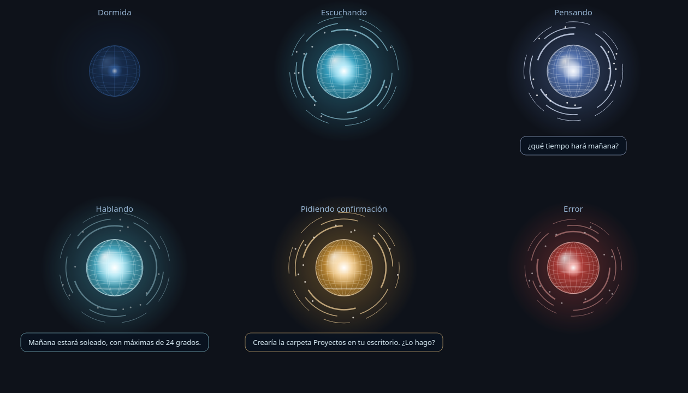

# Asistente Claude 🔵

Un asistente de voz para Linux con forma de **gota de energía flotante con ojos** que usa [Claude Code](https://claude.com/claude-code) como cerebro. Pulsas un atajo o haces clic en la esfera, le hablas y Claude te responde en voz alta... y puede hacer cosas en tu PC, **siempre pidiéndote confirmación antes**.



> Proyecto personal no oficial; no está afiliado ni respaldado por Anthropic.

## Qué hace

- 🎙️ **Di «Oye Claude»** (o pulsa el atajo o haz clic en la esfera). Puedes decirlo todo seguido: *«Oye Claude, ¿qué hora es?»*. La detección de la frase es 100 % local (Vosk con una gramática cerrada, muy ligera); no se envía nada hasta que la dices. Se pausa con juegos a pantalla completa y se puede desactivar desde el menú.
- 🧠 **Claude Code como cerebro**: puede responder preguntas, buscar información, leer archivos, abrir programas... todo lo que Claude Code sepa hacer en tu equipo (incluidos tus conectores/MCP).
- 🛡️ **Seguro por defecto**: Claude trabaja primero en **modo solo lectura**. Si la tarea requiere cambiar algo, te dice qué haría y pregunta *«¿Lo hago?»*; solo actúa si respondes **«sí»**.
- 🗣️ **Voz natural sin internet** con [Piper](https://github.com/rhasspy/piper), y reconocimiento de voz también local: [Vosk](https://alphacephei.com/vosk/) detecta cuándo terminas de hablar y [Whisper](https://github.com/SYSTRAN/faster-whisper) transcribe con mucha más precisión. Lo único que sale de tu PC es lo que se envía a Claude.
- 🔵 **Esfera animada**: una gota gelatinosa con luces que giran por dentro y un borde que ondula con la voz. Tiene ojos de luz que parpadean, siguen al ratón, miran hacia arriba al pensar, se cierran al dormir y sonríen al terminar de hablar. Rebota al hablar, se sorprende al hacerle clic y muestra subtítulos.
- 🕒 **Muestra datos en la esfera**: si preguntas la hora, el clima o un dato corto, la gota se convierte unos segundos en un reloj que anda, un icono del tiempo animado (sol, nubes, lluvia, tormenta, nieve...) o un número grande. Con un **temporizador** muestra la cuenta atrás con un anillo de luz que se va vaciando y, al llegar a cero, suena una alarma y la gota estalla en chispas y vuelve a formarse. Claude lo indica con una etiqueta `[MOSTRAR icono|texto grande|texto pequeño]` que no se lee en voz alta.
- ⏰ **Recordatorios y alarmas**: *«Recuérdame sacar la basura a las ocho»*. A esa hora suena una alarma, la esfera muestra una campana y te lo dice en voz alta. Se guardan en `recordatorios.json`, así que sobreviven a reinicios (si el PC estaba apagado, te avisa al volver).
- 🎨 **Toma los colores de tu fondo de escritorio** (también de Wallpaper Engine) para combinar con él.
- 🎮 **Se oculta sola** con juegos o vídeos a pantalla completa (en KDE Plasma).
- ⚡ **Responde rápido**: empieza a hablar en cuanto tiene la primera frase (sin esperar la respuesta completa), usa un modelo ágil para las preguntas y uno más capaz solo para lo que confirmas.
- 💬 **Recuerda la conversación** entre usos; tras 30 minutos sin hablarle empieza una nueva. Di *«nueva conversación»* para empezar de cero cuando quieras.

## Requisitos

| | |
|---|---|
| **Sistema** | Linux con PipeWire o PulseAudio. Probado en **Bazzite / Fedora con KDE Plasma 6 (Wayland)**. |
| **Claude Code** | Instalado y con sesión iniciada (suscripción Claude Pro/Max o clave de API). |
| **Paquetes** | `python3` (3.10+), `parecord`/`pacat`/`paplay` (paquete `pulseaudio-utils` o `libpulse`), `curl`, `unzip` |
| **Escritorio** | Cualquiera con XWayland o X11. La función de ocultarse con juegos necesita **KDE Plasma**. |

## Instalación

**1. Instala Claude Code** (si no lo tienes) e inicia sesión una vez:

```bash
curl -fsSL https://claude.ai/install.sh | bash
claude        # inicia sesión y luego sal con /exit
```

**2. Descarga e instala el asistente:**

```bash
git clone https://github.com/cecilio120/asistente-claude.git ~/asistente-claude
cd ~/asistente-claude
./instalar.sh
```

El instalador crea un entorno de Python, descarga los modelos de reconocimiento de voz (Vosk ~40 MB y Whisper ~460 MB) y la voz (~60 MB), añade el lanzador al menú y te pregunta si quieres que la esfera arranque al iniciar sesión.

**3. Asigna un atajo de teclado** al lanzador *«Asistente Claude (hablar)»*:

- **KDE:** Preferencias del sistema → Teclado → Accesos rápidos → Añadir nuevo → Aplicación → *Asistente Claude (hablar)* → elige una tecla (p. ej. `Meta+C`).
- **GNOME:** Configuración → Teclado → Atajos personalizados → comando: `~/asistente-claude/venv/bin/python ~/asistente-claude/asistente.py`

¡Listo! Pulsa el atajo (o haz clic en la esfera), espera el pitido y habla.

## Uso

| Acción | Qué hace |
|---|---|
| **Atajo / clic en la esfera** | Empieza a escuchar. Si está ocupada, **cancela** lo que esté haciendo. |
| **Arrastrar la esfera** | La mueve (recuerda la posición). |
| **«Oye Claude»** | Igual que el atajo; si sigues hablando sin pausa, lo que digas después es la orden. |
| **Clic derecho** | Menú: Hablar · Nueva conversación · Escuchar «Oye Claude» (activar/desactivar) · Cerrar asistente. |
| Decir **«nueva conversación»** | Olvida el contexto anterior. |
| Decir **«sí» / «dale» / «adelante»** | Confirma una acción. Cualquier otra cosa (o silencio) la cancela. |

**Colores de la esfera:** salen de tu fondo de escritorio. Con su color principal: tenue y con los ojos cerrados = dormida · brillante y rebotando = hablando. Con un color de acento (el segundo del fondo, o uno que contraste): escuchando · pensando (mirando hacia arriba). Naranja = esperando tu «sí» · rojo = error. Con `colores_fondo: false` usa los colores azules de siempre.

## Configuración

Edita `config.json` (se crea al instalar a partir de `config.example.json`) y reinicia la esfera:

| Opción | Por defecto | Descripción |
|---|---|---|
| `microfono` | `""` | Micrófono a usar (vacío = el predeterminado). Lista los tuyos con `pactl list short sources`. |
| `whisper` | `small` | Modelo de [faster-whisper](https://github.com/SYSTRAN/faster-whisper) (`tiny`, `base`, `small`, `medium`, `large-v3`...). Más grande = más preciso pero más lento. Vacío = solo Vosk. |
| `voz_piper` | `es_MX-claude-high` | Voz de Piper (archivo en `voces/`). |
| `velocidad_piper` | `1.0` | Velocidad de la voz: >1 más lento, <1 más rápido. |
| `permisos_confirmado` | `auto` | Permisos de Claude **tras confirmar**: `auto` o `acceptEdits` (solo editar archivos, sin ejecutar comandos). |
| `directorio` | `~` | Carpeta donde trabaja Claude. |
| `modelo` | `sonnet` | Modelo para responder preguntas (rápido). |
| `modelo_acciones` | `opus` | Modelo para hacer lo que confirmas (programar, cambiar cosas). |
| `esfuerzo` | `low` | Cuánto piensa al responder preguntas (`low`, `medium`, `high`; vacío = predeterminado). |
| `minutos_conversacion` | `30` | Tras estos minutos sin hablarle empieza una conversación nueva (un historial largo la hace más lenta). |
| `segundos_max_orden` | `30` | Tiempo máximo hablando. |
| `segundos_silencio` | `1.2` | Segundos de silencio tras los que deja de escucharte (súbelo si te corta al hacer pausas). |
| `segundos_confirmacion` | `6` | Tiempo para decir «sí». |
| `escala_orbe` | `1.0` | Tamaño de la esfera. |
| `oye_claude` | `true` | Escuchar en segundo plano la frase «Oye Claude» (también desde el menú del clic derecho). |
| `colores_fondo` | `true` | La esfera toma los colores del fondo de escritorio (KDE, imagen o Wallpaper Engine). |
| `subtitulos` | `true` | Mostrar el texto debajo de la esfera. |

**Cambiar de voz:** hay voces en español de España, México y Argentina en el [catálogo de Piper](https://huggingface.co/rhasspy/piper-voices/tree/main/es). Por ejemplo:

```bash
VOZ=es_ES-davefx-medium ./instalar.sh
```

## Activar, desactivar y desinstalar

```bash
./desactivar.sh    # cierra la esfera y la quita del inicio automático (no borra nada)
./activar.sh       # la vuelve a poner en el inicio automático y la abre
./desinstalar.sh   # lo elimina todo (pide confirmación)
```

El atajo de teclado hay que quitarlo a mano desde la configuración del sistema.

## Solución de problemas

- **No me escucha:** probablemente está usando otro micrófono. Mira `pactl list short sources` y pon el nombre correcto en `microfono` dentro de `config.json`. Comprueba también que no esté silenciado.
- **No responde / error en rojo:** revisa `asistente.log`. Asegúrate de que `claude -p "hola"` funciona en una terminal.
- **La esfera no aparece:** ejecuta `./venv/bin/python orbe.py` en una terminal para ver el error. Necesita XWayland (viene activado por defecto en KDE y GNOME).
- **Entiende mal lo que digo:** prueba un modelo de Whisper más grande (`"whisper": "medium"`) y habla cerca del micrófono. Claude está avisado de que puede haber errores de transcripción e intenta deducir la intención. En `asistente.log` puedes ver lo que entendió.

## Desarrollo

Abre la carpeta en VS Code (`code ~/asistente-claude`) e instala las extensiones recomendadas. Hay tareas (`Ctrl+Shift+P` → *Run Task*) para instalar, reiniciar la esfera, activarla o ver el registro, y configuraciones de depuración para `orbe.py`.

> **VS Code desde Flatpak:** el editor corre en un sandbox, así que para ejecutar o depurar usa la terminal del sistema, o da acceso al host con `flatpak override --user --talk-name=org.freedesktop.Flatpak com.visualstudio.code` y abre la terminal integrada con `host-spawn`.

| Archivo | Qué es |
|---|---|
| `orbe.py` | La esfera (PyQt6): dibujo, ojos, animaciones, colores del fondo, ratón, socket local y D-Bus. |
| `asistente.py` | El núcleo: micrófono → Vosk + Whisper → Claude Code → Piper. Ejecutado directamente, actúa como el «botón» del atajo. |
| `kwin_pantalla_completa.js` | Script de KWin que avisa a la esfera cuando hay algo a pantalla completa. |
| `instalar.sh` / `activar.sh` / `desactivar.sh` / `desinstalar.sh` | Instalación y gestión. |

## Licencia

[MIT](LICENSE)
